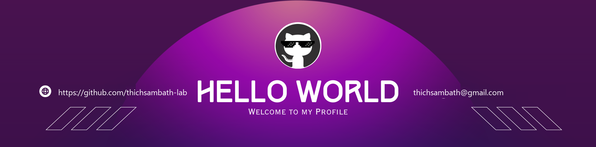
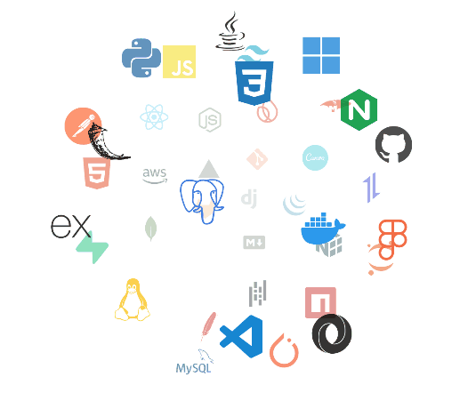

<!--Banner-->

<!--Night Owl image-->

  

<!--Header Name-->
#  ɪ'ᴍ sᴀᴍʙᴀᴛʜ! 
*Digital Craftsman (Developer / Programmer)*
  

<!--Start Intro-->               

I am a Software Engineering Student and Full Stack Web Developer with a huge passion for Python, JavaScript, React, HTML/CSS, Lua, C++, and building impactful tools.

- ✨ Student of life :)
- 🌱 I’m currently learning many things, I believe that everyday is a learning opportunity.
- 🎓 Second-year Software Engineering student at [Cambodia Academy of Digital Technology (CADT)](https://www.cadt.edu.kh).
- 🏙 Based in Phnom Penh, Cambodia 🇰🇭.
- 🎯 Most interested in web development and creating tools that help the people around me.
- 🤝 Always happy to collaborate on projects or help classmates who are just starting to code.
- 💻 Visit my [GitHub Profile](https://github.com/thichsambath-lab) for more details about me.
<!--End Intro-->

<!--Profile Count Badge-->

  

---

<!--Languages and Tools Section-->       
<h2 align="center">Tᴇᴄʜ sᴛᴀᴄᴋ & Pʀᴏᴊᴇᴄᴛs</h2> 
<picture>
  <source media="(prefers-color-scheme: dark)" srcset="./Skills_Animation_Dark.gif">
  <source media="(prefers-color-scheme: light)" srcset="./Skills_Animation_White.gif">
  
</picture>
 

<h3 align="left">Current Learning</h3>
<ul align="left">
  <li>Deepening my knowledge in Python, JavaScript, and React.js.</li>
  <li>Exploring VR / interactive education applications with C# and Unity.</li>
  <li>Improving my skills in modern web development with TypeScript and Vite.</li>
</ul>
  
<h3 align="left">Featured Projects</h3>
<ul align="left">
  <li><a href="https://github.com/thichsambath-lab/V-04-VR-for-Education-">🥽 <strong>V-04-VR-for-Education-</strong>: Immersive VR educational experience</a></li>
  <li><a href="https://github.com/thichsambath-lab/tool-record-video-">🎥 <strong>tool-record-video-</strong>: Desktop video recording tool with Python GUI</a></li>
  <li><a href="https://github.com/thichsambath-lab/VIBELEARN">🚀 <strong>VIBELEARN</strong>: Interactive full-stack learning platform</a></li>
  <li><a href="https://github.com/thichsambath-lab/FixFlow">⚡ <strong>FixFlow</strong>: Modern web app built with React, TypeScript & Vite</a></li>
</ul>
 
 
 
 

<!--Trophies Section-->   
<h2 align="center">🏆 Gɪᴛʜᴜʙ Tʀᴏᴘʜɪᴇs 🏆</h2>

  <a href="https://github.com/thichsambath-lab">
    <picture>
      <source media="(prefers-color-scheme: dark)" srcset="https://github-profile-trophy-ruddy.vercel.app/?username=thichsambath-lab&no-bg=true&row=2&column=6&margin-w=20&margin-h=20&theme=monokai">
      <source media="(prefers-color-scheme: light)" srcset="https://github-profile-trophy-ruddy.vercel.app/?username=thichsambath-lab&no-bg=true&row=2&column=6&margin-w=20&margin-h=20">
      
    </picture>
  </a>

 

<!--Github stats Table--> 
<h2 align="center">📊 Gɪᴛʜᴜʙ Sᴛᴀᴛs 📊</h2>

<table width="100%">
  <tr>
    <td width="50%">
      <h3 align="center"><strong>Gɪᴛʜᴜʙ Sᴛᴀᴛs</strong></h3>
      

        
      

    </td>
    <td width="50%">
      <h3 align="center"><strong>Sᴛʀᴇᴀᴋ Sᴛᴀᴛs</strong></h3>
      

        
      

    </td>
  </tr>
  <tr>
    <td width="50%">
      <h3 align="center"><strong>Fᴇᴀᴛᴜʀᴇᴅ Pʀᴏᴊᴇᴄᴛ</strong></h3>
      

        
      

    </td>
    <td width="50%">
      <h3 align="center"><strong>Lᴀᴛᴇsᴛ Pʀᴏᴊᴇᴄᴛ</strong></h3>
      

        
      

    </td>
  </tr>
  <tr>
    <td width="50%">
      <h3 align="center"><strong>VR Pʀᴏᴊᴇᴄᴛ</strong></h3>
      

        
      

    </td>
    <td width="50%">
      <h3 align="center"><strong>Tᴏᴏʟ Pʀᴏᴊᴇᴄᴛ</strong></h3>
      

        
      

    </td>
  </tr>
</table>
 

<!--Contribution Graph-->
<h2 align="center">📈 Cᴏɴᴛʀɪʙᴜᴛɪᴏɴ Gʀᴀᴘʜ 📈</h2>

  

---

<!--Dynamic Quote card--> 
<h2 align="center">🌟 Tʜᴏᴜɢʜᴛ ᴏғ ᴛʜᴇ Dᴀʏ 🌟</h2>

  

<!--Contact Section--> 
<h2 align="center">🤝 Cᴏɴɴᴇᴄᴛ Wɪᴛʜ Mᴇ 🤝 </h2>

  

 

<!--Footer--> 

  

